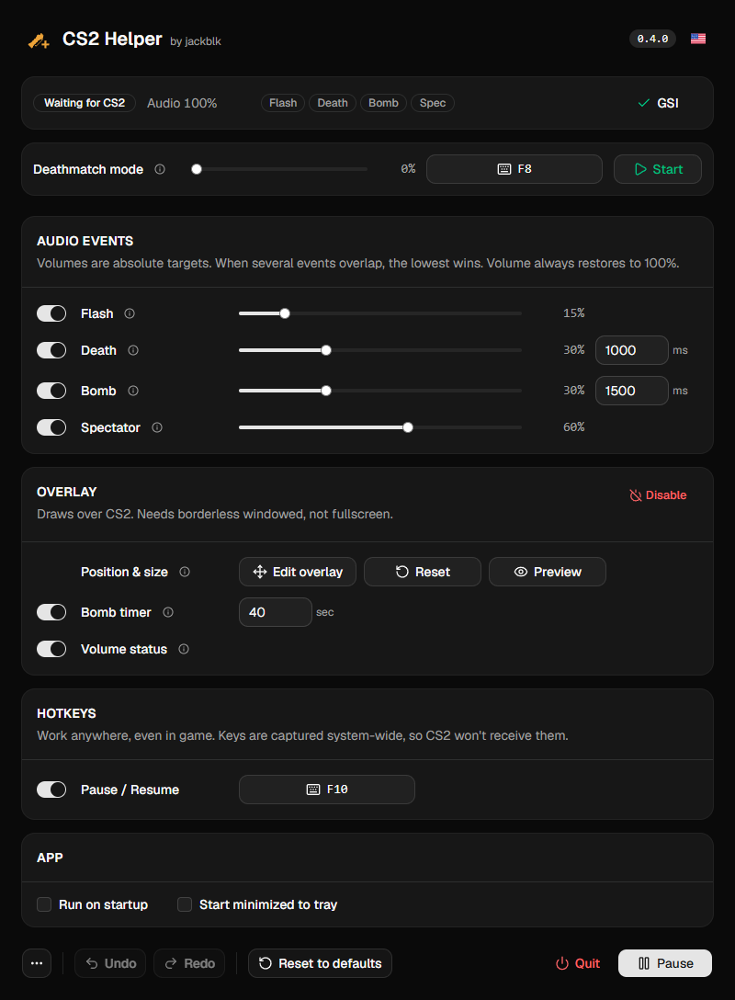
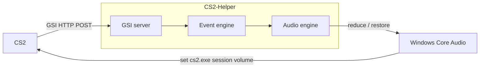

# CS2 Helper

[](https://github.com/jackblk/cs2-helper/releases)

A utility for accessibility in **Counter-Strike 2**. It automatically reduces **only CS2's** per-app volume during loud in-game events and restores it afterward.

**Features, screenshots and FAQ: [homepage](https://jackblk.github.io/cs2-helper/).**

Download the latest release: [CS2.Helper-x64.exe](https://github.com/jackblk/cs2-helper/releases/latest/download/CS2.Helper-x64.exe), or pick another one from the [Releases page](https://github.com/jackblk/cs2-helper/releases).



## Supporters

<a href="https://ko-fi.com/jackblk" target="_blank">
  
</a>

## How it works



* **GSI:** the app writes `gamestate_integration_cs2helper.cfg` into `<CS2 install>\game\csgo\cfg` (found through the Steam registry and `libraryfolders.vdf`). CS2 then posts game state to a local server on `127.0.0.1:31211`, authenticated with a per-install token.
* **Audio:** only the `cs2.exe` session is touched, through Windows Core Audio. Volumes are absolute targets (not relative to your current level). When several reductions overlap, the lowest one wins, and the volume always restores to 100%.
* **Overlay:** a separate transparent, click-through, always-on-top window, driven by the same GSI data. No injection, memory reads or game file changes.

## Configuration

Settings live in `%APPDATA%\com.jackblk.cs2-helper\config.toml`.

* The app saves every change automatically, keeping the file's comments.
* The file is human-editable. After editing it by hand, use **Reload config** (the `⋯` menu or the tray).
* Settings added in a new version are appended to your file on load; existing values are never touched.
* **Reset to defaults** backs up the old file to `config.toml.bak` first.

## Notes

* **Windows 11 only.** The audio backend is Windows-specific.
* **The overlay needs borderless windowed** (fullscreen windowed). Exclusive fullscreen hides any external overlay.
* **The bomb timer is approximate.** CS2 adds a small random detonation delay and GSI does not report the exact plant time, so treat it as a guide, not an exact clock.
* **Hotkeys are captured system-wide** (Win32 `RegisterHotKey`, no keyboard hooks), so CS2 never receives a key bound in the app.
* **Deathmatch mode is manual.** Community deathmatch servers report their mode as `custom`, so it cannot be detected reliably. It is off at every launch.

## FAQ

The common questions (anti-cheat, safety, Linux) are answered on the [homepage](https://jackblk.github.io/cs2-helper/).

### Did you use AI?

Yes, it's just a tool. I'm a dev myself, I came up with the architecture, decisions. Feel free to contribute if you want to add features or improve the codebase.

### I want to add X feature

Feel free to create an issue or, better, a pull request. I can't promise I'll merge every contribution, but I'm open to new features and improvements.

## Development

### Stack

* **App:** Tauri v2 (Rust) + React, Vite, Tailwind, shadcn/ui, react-i18next
* **Audio:** windows-rs (Core Audio)
* **Homepage:** Astro, in `site/` (a pnpm workspace package)

Architecture and conventions are in [AGENTS.md](./AGENTS.md).

### Commands

```sh
pnpm install
pnpm tauri dev           # run the app with hot reload (Vite + Rust)
pnpm build               # typecheck + build the frontend
pnpm test                # frontend unit tests (Vitest)
pnpm format              # format with Biome
pnpm tauri build         # build the Tauri app (release mode)
pnpm site:dev            # run the homepage locally
pnpm screenshot:windows  # capture the running app into site/public/screenshot.png
```

Rust typecheck and tests:

```sh
cargo check --manifest-path src-tauri/Cargo.toml
cargo test --manifest-path src-tauri/Cargo.toml
```

### Releasing

`package.json` holds the version; `pnpm bump` keeps `Cargo.toml` and `Cargo.lock` in sync.

```sh
pnpm bump 0.4.1   # set the version everywhere, then commit and push
pnpm release      # confirm, then tag and push; CI builds a draft GitHub release
```

## References

* Inspired by [PatrikZeros CSGO Sound Fix](https://github.com/patrikzudel/PatrikZeros-CSGO-Sound-Fix)
* [GSI API reference from u/Bkid](https://www.reddit.com/r/GlobalOffensive/comments/cjhcpy/game_state_integration_a_very_large_and_indepth/)
* [CS2 GSI docs](https://developer.valvesoftware.com/wiki/Counter-Strike_2_Game_State_Integration)
